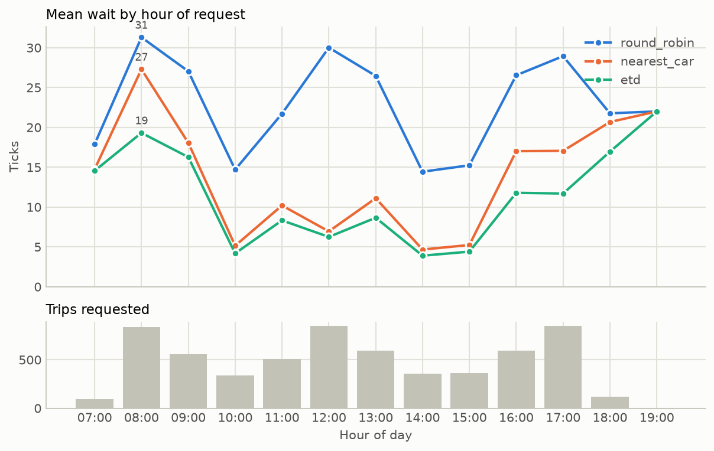
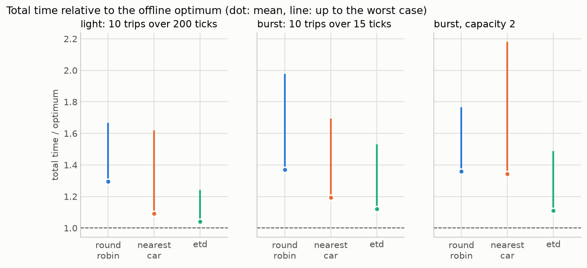

# Elevator Dispatch Simulator

A discrete-time simulation of a multi-elevator building using destination
dispatch, built to compare scheduling algorithms against the three objectives
of the problem statement: serve every request, minimize each passenger's
total time (wait plus ride), and honor capacity and direction of travel. The
problem statement is in [`docs/challenge.md`](docs/challenge.md); working
design notes and recorded trade-offs are in [`CLAUDE.md`](CLAUDE.md).

## Quick start

Requires Python 3.14+ and [uv](https://docs.astral.sh/uv/).

```bash
uv sync
uv run python -m elevator_sim run         # one dispatcher (ETD) on the bundled office day
uv run python -m elevator_sim compare     # every dispatcher on the same input, side by side
uv run python -m elevator_sim benchmark   # dispatchers against the exact optimum on tiny cases
```

The problem statement's sample input, in its 60-floor building:

```bash
uv run python -m elevator_sim run --requests data/sample_requests.csv --floors 60 --elevators 4 --capacity 12
```

## Commands and options

| Option | Default | Meaning |
|---|---|---|
| `--requests` | `data/office_day.csv` | CSV with header `time,id,source,dest` (also `ELEVATOR_REQUESTS_CSV`) |
| `--dispatch` (`run` only) | `etd` | `round_robin`, `nearest_car` or `etd` |
| `--floors` | 40 | Floors, numbered 1..floors; floor 1 is the lobby |
| `--elevators` | 8 | Number of elevators |
| `--capacity` | 16 | Maximum passengers per elevator |
| `--start-floor` | 1 | Floor where every elevator starts |
| `--stop-duration` | 1 | Ticks per stop (doors, boarding, alighting) |
| `--max-ticks` | 100000 | Safety cap on simulation length |
| `--seeds` (`benchmark` only) | 100 | Random cases per scenario |
| `--out` | `results` | Directory for the logs and the chart |

Every command prints the same table and writes its files to `--out`:

| Command | Files |
|---|---|
| `run` | `positions.csv`, `passengers.csv`, `wait_by_hour.png` |
| `compare` | `positions_<dispatcher>.csv` and `passengers_<dispatcher>.csv` per dispatcher, `wait_by_hour.png` |
| `benchmark` | `benchmark.png` |

Input that does not fit the settings is rejected before the run, with every
offending row and the value that would fit, for example
`num_floors must be at least 51`.

## Output

1. **Elevator positions log** (`positions.csv`): one row per tick starting at
   `t=0`, with every elevator's floor: `time,e0,e1,...`
2. **Passenger log** (`passengers.csv`): one row per passenger with their car,
   request, pickup and drop-off ticks, wait, travel, total, intermediate
   stops and how many times their car left their floor without them. Blank
   times mean the run ended first.
3. **The table.** One column per dispatcher, rows grouped under the three
   objectives plus a Fleet line. This is `compare` on the office day:

   ```
   office_day.csv: 6078 passengers; 40 floors, 8 cars, capacity 16, stop duration 1

                          round_robin  nearest_car          etd
   1. Serve every request
     delivered                  6078         6078         6078
     wait max                     82          113           48*
     total max                   119          156           87*
     left behind, most             0*           1            0*
   2. Minimize total time
     wait min                      0            0            0
     wait mean                  25.4         13.9         10.7*
     wait p95                     62           46           33*
     total min                     2            2            2
     total mean                 44.3         34.3         30.6*
     total p95                    89           77           67*
     stops mean                  0.6*         2.1          1.6
   3. Honor capacity and direction
     constraints                held         held         held
     max load                      7           16           16
     full car-ticks                0*         146           73
     left behind                   0*         106            0*
   Fleet
     deadhead                    48%          31%*         33%
   ```

   Times are in ticks (one tick is one floor of travel). **Wait** is request
   to pickup; **total** is wait plus the ride; **stops** are the stops a
   rider sits through between boarding and alighting. The two maxima sit
   under objective 1 because "no passenger waits indefinitely to be picked
   up or dropped off" is what they check. **Left behind** counts departures
   where a car moved off a floor without one of its own passengers who was
   going its way; **left behind, most** is the worst repeat for one
   passenger, the starvation signal. **Constraints** reads `held` when the
   load never exceeded capacity and no rider was carried away from their
   destination on this run, and `VIOLATED` otherwise. **Full car-ticks**
   tells you whether capacity was exercised at all. **Deadhead** is the
   share of moving ticks with nobody aboard. `*` marks the best dispatcher
   in rows that have a direction; the two minima are reported but not
   ranked. `benchmark` prints the same rows averaged over seeds, adds an
   `optimum` column, and two rows under objective 2: `total / optimum`, mean
   and worst case.
4. **Charts.** `run` and `compare` draw mean wait by hour of request, one
   line per dispatcher, over the trips requested that hour. `benchmark`
   draws each dispatcher's ratio to the optimum per scenario (dot: mean,
   line up to the worst case). The hour axis uses the office day's clock,
   2,400 ticks per hour from 07:00; other inputs are bucketed on it too.

## How it works

**Time.** One tick is one floor of travel. The loop advances one tick at a
time, including idle stretches, and each tick runs:

1. **Ingest** requests whose time has come. The scheduler never sees a request
   before its time; this is enforced in one place, `RequestSource.arrivals_at(t)`.
2. **Assign** each new passenger to an elevator, permanently (destination dispatch).
3. **Decide** each elevator's action (move, stop or idle) with the LOOK movement policy.
4. **Apply** it: alight, then board up to capacity, or move one floor.
5. **Record** one positions row.

The run ends once every request has arrived and every passenger is delivered.

**Movement (LOOK).** A car keeps going in its direction while it has pickups or
drop-offs ahead, then reverses. It stops on a floor for a drop-off or for a
pickup going its way, and boards only passengers travelling in its direction
of departure. A car that is full ignores pickups until riders get off.
Boarding is oldest request first, and a departing car keeps a seat for every
older passenger of its own who waits further along the sweep going the same
way, so a newer crowd can never fill the car past an older passenger upstairs.

**Dispatchers.** Movement is LOOK for all of them; only the choice of car differs.

| Dispatcher | How it assigns a request |
|---|---|
| Round robin | Cars take turns. Baseline. |
| Nearest car | The car that reaches the caller in the fewest floors, from its position, direction and the end of its current sweep. Ignores stops, load and delay to other passengers. |
| ETD (estimated time to destination) | For each car, simulate its LOOK route with and without the new passenger and sum, over everyone the car is responsible for, the ticks until they reach their destination. Pick the car whose sum grows least. This counts the new passenger's wait and ride, the delay their stops cause everyone already assigned, and full cars. |

ETD's predictions run the same per-car rules as the simulation
(`physics.step`), so a prediction made after a car's last assignment matches
the run tick for tick; a test checks this.

**Code layout** (`elevator_sim/`; each layer only calls the ones below it)

| Layer | Modules |
|---|---|
| Commands | `cli.py` (`run`, `compare`, `benchmark`), `experiments.py` (the comparison), `benchmarks.py` (the offline optimum), `viz.py` (the two charts) |
| Configuration | `config.py`, `registry.py` |
| Core loop | `simulation.py` |
| Strategies | `dispatch/` (round robin, nearest car, ETD, fixed), `movement/look.py` |
| Input and output | `elevator_requests.py`, `workloads.py`, `recorder.py`, `metrics.py`, `report.py` |
| Models | `models.py`, `physics.py` |

## Decisions

### Assumptions, from the problem statement

- One tick is one floor of travel, up or down; there is no acceleration.
- A request at tick `t` can board at tick `t`. Pickup is the boarding tick,
  drop-off the alighting tick, so the sample's passenger 1 (floor 1 to 51,
  idle car at the lobby) boards at 0 and alights at 51.
- Assignment is permanent: the controller names a car when the request is
  made and never changes it, even if the car arrives full.
- Input is a finite list, sorted by time if it is not already. Rows with
  `source == dest`, duplicate ids or negative times are rejected with their
  row number.
- Floors are numbered from 1; floor 1 is the lobby, where every car starts.

### Simplifications

- **Stop duration 1 by default**, about 1.5 s at the office day's scale,
  where a real door cycle is 8–10 s. The ranking does not depend on it;
  each row below is one `compare` run with that option (mean wait / max
  wait in ticks):

  | Setting | Round robin | Nearest car | ETD |
  |---|---|---|---|
  | Defaults (stop duration 1, capacity 16) | 25.4 / 82 | 13.9 / 113 | **10.7 / 48** |
  | `--stop-duration 3` | 29.1 / 110 | 15.4 / 227 | **10.9 / 60** |
  | `--stop-duration 6` | 35.9 / 147 | 20.0 / 298 | **13.2 / 82** |
  | `--capacity 6` | 25.4 / 82 | 68.3 / 860 | **12.1 / 49** |

  ETD's lead grows with stop cost, because its cost counts stops and nearest
  car's does not; a one-tick stop flatters every dispatcher.
- **One movement policy.** Every dispatcher moves under LOOK, so the
  comparison isolates the choice of car. The offline optimum is therefore
  the best assignment under LOOK, not the best possible system.
- **No door or acceleration model.** A stop costs the same however many
  people board, and a one-floor hop costs one tick like any other floor.
- **One synthetic day, one committed seed.** `data/office_day.csv` is a
  40-floor tower with about 1,400 occupants from 07:00 to 20:00, generated
  by `workloads.py` (morning up-peak, two-way lunch, inter-floor meetings,
  evening down-peak). A test keeps the file in sync with the generator.
- **A one-tick clock.** Idle stretches are simulated tick by tick, as the
  problem statement asks. Round robin runs the 31,200-tick day in about a
  second; ETD takes 10–15 s because it predicts two routes per request.

### Trade-offs

- **Seat reservation.** A departing car keeps a seat for each older
  passenger of its own waiting further along its sweep. Without it a rider
  upstream of the lobby was passed by a full car on every trip for as long
  as the morning stream lasted (1,196 ticks in a probe), so "eventually
  served" only meant "once the input runs out". With it, newer passengers
  never overtake an older one: the oldest passenger still waiting for a car
  boards within one sweep, or three legs if the car was full at that moment.
  The cost is a seat that may ride empty for a few floors; at capacity 16
  the office-day numbers did not move. The rule guarantees order, not speed.
- **ETD minimizes the plain sum of time.** A convex cost on cumulative wait
  (the fairness lever) was built, measured and removed: on the office day,
  exponents from 1.5 to 3 moved mean wait by at most 0.1 tick and the
  longest wait by at most 4 ticks, because a passenger's wait is set by
  where their car is in its sweep, which the choice of car rarely changes.
  Fairness has to come from movement or re-dispatch, both out of scope.
- **Capacity is not reserved at assignment.** Riders alight along the route,
  so reserving a seat for the whole trip would be too conservative. A
  passenger left behind keeps their car, which comes back for them; ETD
  sees the full car in its prediction and assigns elsewhere.
- **Ties rotate.** Requests in one tick keep their input-file order. Among
  equally good cars the first after the one chosen last wins, so idle cars
  waiting together at the lobby share a crowd instead of all losing to car 0.
- **The optimum is exact because cars never interact.** Permanent
  assignment makes each car's route depend only on its own passengers, so
  the best assignment is found by simulating every passenger subset on one
  car and combining subsets by dynamic programming; a test checks it against
  brute force. It is limited to 16 passengers, so it calibrates dispatchers
  on tiny cases and `compare` reports large workloads without a bound.

### Future work

- **Zone-based dispatch** (low-rise and high-rise groups sharing the lobby)
  and **express elevators**; a trip spanning zones would fall back to ETD.
- **Idle-car parking.** Cars park where they last dropped off, and a third
  to a half of all movement carries nobody. Returning idle cars to the
  lobby before a peak is the next movement-layer feature.
- **Fairness through movement:** reverse early for a pickup that has waited
  past a threshold. The benchmark's exact search can give the least possible
  longest wait as the yardstick.
- **Streaming input.** `RequestSource` is the one swap point, but a stream
  needs a policy for late or out-of-order arrivals, which a list can sort.
- **ETD speed and horizon.** About 1.9 ms per assignment; an incremental
  route cost or an event-driven clock would help more than caching, since
  only arrivals that share a tick could reuse a route. ETD predicts whole
  routes with `--max-ticks` as its horizon, so a cap shorter than a route is
  reported as an error rather than degraded.
- **More seeds and a larger bound.** Results are from one committed seed;
  beyond 16 passengers a strong heuristic could stand in for the optimum.

## Results

### Office day (`compare`)

The table in Output above. ETD has the lowest wait and total time at every
percentile. Nearest car gets much of ETD's average gain but has the worst
tail: it keeps sending callers to whichever car is closest, which can strand
someone behind a long sweep. Round robin spreads riders thinly, so they share
cars least and make the fewest stops, but they wait far longer and half of
their cars' movement carries nobody. With 16 seats cars are rarely full, so
this table barely exercises capacity.



By hour of day the gap is a peak-hour gap: nearest car is within a few ticks
of ETD mid-morning and mid-afternoon and loses at 08:00 and 17:00, when
callers pile onto whichever car happens to be close. Round robin is slow all
day.

### When capacity binds (`compare --capacity 6`)

| Per trip | Round robin | Nearest car | ETD |
|---|---|---|---|
| Wait mean / p95 / max | 25.4 / 62 / 82 | 68.3 / 347 / 860 | **12.1 / 35 / 49** |
| Total mean / max | 44.3 / 119 | 87.9 / 894 | **31.4 / 92** |
| Left behind, most (one passenger) | 1 | 11 | **0** |
| Full car-ticks | **59** | 3,044 | 2,416 |
| Departures leaving a passenger behind | 1 | 4,646 | **0** |

Nearest car collapses: it keeps sending lobby callers to the same nearby car,
whose queue grows faster than it can be served, and one passenger watched
their car leave eleven times before boarding. ETD predicts the full car and
assigns elsewhere, so nobody is left behind at all. Round robin spreads
riders so thinly that capacity rarely binds. Seat reservation keeps this
fair (nobody is overtaken by a newer passenger) but cannot make an
overloaded car faster; that is the dispatcher's job.

### Against the offline optimum (`benchmark`)

Comparing with round robin only shows a dispatcher is not bad. On tiny cases
(10 trips, 20 floors, 3 elevators, 100 random cases per scenario) the best
possible assignment is known exactly, and `benchmark` prints the full table
per scenario with the optimum as a fourth column. Its two extra rows, total
time divided by the optimum's, mean (worst case):

| Scenario | Round robin | Nearest car | ETD |
|---|---|---|---|
| Light: 10 trips over 200 ticks | 1.30 (1.67) | 1.09 (1.62) | **1.04 (1.24)** |
| Burst: 10 trips over 15 ticks | 1.37 (1.98) | 1.19 (1.69) | **1.12 (1.53)** |
| Burst, capacity 2 | 1.36 (1.77) | 1.34 (2.18) | **1.11 (1.49)** |



ETD averages 4–12% above the best possible assignment. Part of the remaining
gap is the value of knowing future requests, which no real-time dispatcher
can recover. Nearest car falls back to round robin's level when cars fill up,
because it ignores load. A regression test keeps ETD within 12% of the
optimum on fixed burst cases.

## Testing

`uv run pytest` runs the suite (about 30 s), including:

- the sample input hand-traced tick by tick, per passenger and per car
- the no-peek rule
- LOOK direction rules and the stops identity `travel = distance + 1 + stops`
- capacity, seat reservation and starvation: a newer passenger never
  overtakes an older one on the same car
- the wait bounds at capacity 2, 4 and 1,000
- the table: rows grouped by objective, stars, the reference column, seed
  averages, and the CLI's three commands and their files
- ETD predictions matching the run exactly, and its cost definition
- the offline optimum against brute force, and ETD's distance from it
- both charts rendering from results

## Time spent - 11.5 hr

Planning + Elevator Algo Research - 1.5 hrs
Skeleton CLI - 1hr
End To End Simulation LOOK + ROUND ROBIN - 2hr
Plugin Round Robin + config refactor  - 2 hr
Plugin Nearest Car + Metrics to compare algos - 2 hr
Refactor CLI + metrics presentation - 3 hr

